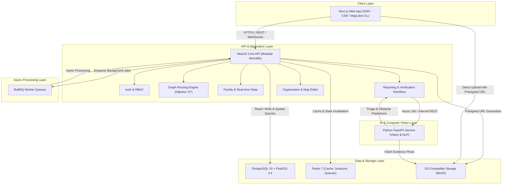

# PathPulse System Architecture

## System Overview

PathPulse is an intelligent accessibility and multi-floor navigation platform that connects people with specific mobility requirements to verified indoor and outdoor navigable journeys.

## Architecture Decision Records (ADR)

### ADR-001: Modular Monolith over Microservices

- **Context**: PathPulse requires transactional integrity across venues, multi-floor graphs, facilities, crowdsourced reports, and audit trails. Building distributed microservices early introduces network hops, eventual consistency challenges, dual-write complexities, and operational overhead.
- **Decision**: Adopt a modular monolith built on NestJS inside a unified monorepo. Modules (`auth`, `venues`, `navigation`, `facilities`, `reports`, `audit`) are logically bounded with strict dependency boundaries and shared type contracts.
- **Consequences**: Fast local development, atomic ACID transactions for route graph and facility state changes, simplified deployments, and clean boundary separation that permits splitting out high-throughput services later if required.

### ADR-002: PostgreSQL with PostGIS over MongoDB

- **Context**: Navigation requires relational graph integrity (nodes, edges, floors, buildings, facilities) alongside native spatial geospatial indexing and calculations (geofencing, finding nearest accessible entrances via spherical distance).
- **Decision**: Use PostgreSQL 16 with the PostGIS 3.4 spatial extension.
- **Consequences**:
  - Full relational integrity: Foreign key constraints, unique composite keys, check constraints, and transactional rollbacks.
  - Native spatial power: PostGIS `geography(Point, 4326)` with spatial GiST indexing enables performant k-nearest-neighbors (`<->`) and distance queries.
  - Complex graph queries: PostgreSQL recursive CTEs and typed relationships outperform document databases for structured multi-floor topological graphs.

### ADR-003: AI Service Behind an Isolated Service Boundary

- **Context**: Barrier classification, duplicate report clustering, and visual obstacle recognition benefit from Python's machine learning and computer vision ecosystem (PyTorch, OpenCV, Transformers).
- **Decision**: Isolate AI processing within an asynchronous Python FastAPI service. The NestJS core API communicates with it via asynchronous BullMQ queues or isolated internal REST calls.
- **Consequences**:
  - Independent runtime environments: Node.js handles I/O-intensive navigation queries and WebSockets, while Python manages memory-heavy image and tensor operations.
  - Failure containment: Heavy computer vision jobs or ML failures never block core navigation, authentication, or reporting operations.
  - Strict human verification invariant: The AI service returns suggestions (confidence scores, detected barrier classes); core business logic marks all AI outputs as suggestions requiring human or moderator verification before committing state changes.
