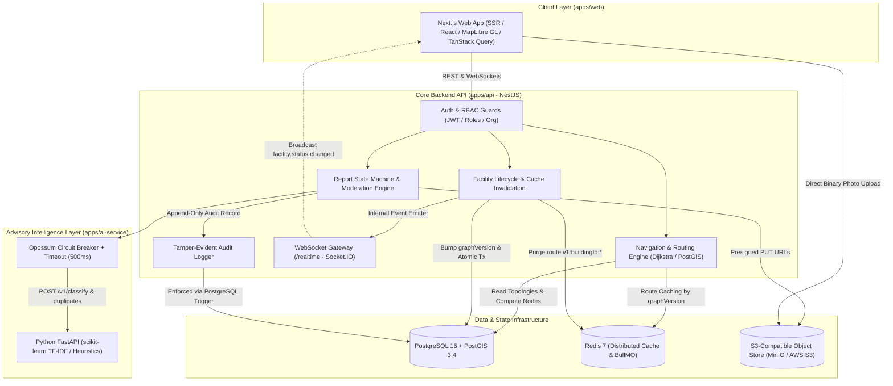

# PathPulse System Architecture & Technical Specification

## 1. System Overview and Purpose

PathPulse is an enterprise-grade accessibility and multi-floor indoor/outdoor navigation platform designed for high-density institutions (campuses, healthcare facilities, transit hubs, and cultural venues). The platform pairs topological graph routing with verified, crowdsourced barrier intelligence, ensuring that individuals with mobility challenges receive reliable, step-free journeys.



---

## 2. Core Architectural Invariants

PathPulse enforces six non-negotiable architectural invariants:

1. **The Verification Principle**: No route is presented to an end user as "accessible" unless the navigation engine confirms `STEP_FREE` pathing and every intermediate edge segment is in `CONFIRMED` status. Route safety is never computed, filtered, or assumed on the client.
2. **Direct-to-Storage Evidence Ingestion**: Application servers never handle or stream photographic media bytes. Clients receive short-lived (15-minute), presigned PUT URLs signed with IAM least-privilege credentials. Server verification requires an explicit `HEAD` object probe to validate file size and MIME type.
3. **Pure Function State Transitions**: The report verification and moderation state machine is implemented as a pure function (`transitionReport`) without external I/O or framework dependencies. Roles, transition tables, self-action prohibitions, and separation of duties are mathematically verified in memory.
4. **Tamper-Evident Append-Only Auditing**: Every status change and security transition writes an immutable row into `audit_logs`. A PostgreSQL database trigger (`prevent_audit_logs_tamper`) unconditionally rejects any `UPDATE` or `DELETE` statement executed against the audit table.
5. **Human-in-the-Loop AI Advisory Separation**: The Python AI service produces suggestions only. Every AI response carries `requiresHumanVerification: true` enforced by schema validation and database check constraints. AI output is strictly isolated from report state transitions.
6. **Graph Version Cache Correctness**: Accessibility facility outages atomically bump `buildings.graph_version` inside the database transaction. Because cache keys incorporate `graphVersion`, stale routes are instantly invalidated without cache race conditions.

---

## 3. Monorepo Organization and Boundaries

```
pathpulse/
├── apps/
│   ├── api/                    # NestJS Core Backend (REST, WebSockets, Prisma, BullMQ)
│   │   ├── prisma/             # Schema, migrations, and seed scripts
│   │   └── src/                # Modular domain features (auth, navigation, reports, etc.)
│   ├── web/                    # Next.js Frontend (App Router, Tailwind CSS, MapLibre GL)
│   │   ├── app/                # Route segments (explore, routes, reports, org, public)
│   │   └── lib/                # API client, React Query hooks, and accessibility utilities
│   └── ai-service/             # Python FastAPI Service (NLP classification, duplicate scoring)
│       ├── app/                # Endpoints, schemas, TF-IDF classifier, summarizer
│       └── tests/              # Pytest test suite and evaluation datasets
├── packages/
│   ├── shared-types/           # Shared TypeScript interfaces, DTOs, and domain enums
│   └── validation/             # Shared validation schemas (zod / class-validator parity)
├── docs/                       # Architectural specs, API reference, runbooks, and ADRs
└── docker-compose.prod.yml     # Production-grade multi-container specification
```

---

## 4. Subsystem Deep Dive

### 4.1 Navigation & Route Planning Engine
- **Graph Topology**: Nodes represent 3D physical coordinates (`x, y, floor, latitude, longitude`). Edges represent navigable corridors, ramps, elevators, and doors.
- **Mobility Profiles**: Supports `WHEELCHAIR` (strictly step-free, maximum slope constraints, accessible width thresholds), `ASSISTED` (step-free preferred, elevator priority), and `STANDARD`.
- **Confidence Computation**: Each segment reports an explicit confidence level (`CONFIRMED`, `UNVERIFIED`, `UNAVAILABLE`) derived from physical facility states and recent barrier reports.
- **Caching Strategy**: Routes are keyed by `route:v1:${buildingId}:${graphVersion}:${profile}:${originId}:${destId}` with a 24-hour TTL in Redis.

### 4.2 Facility State & Graph Version Invalidation
When an institution updates the status of an elevator or door:
1. `SELECT ... FOR UPDATE` acquires an exclusive lock on the facility.
2. The facility's operational status and verification level are updated.
3. The parent building's `graph_version` is atomically incremented (`UPDATE buildings SET graph_version = graph_version + 1`).
4. An immutable row is inserted into `audit_logs`.
5. The database transaction commits.
6. Asynchronous Redis purge cleans keys matching `route:v1:${buildingId}:*`.
7. An internal `facility.status.changed` event triggers the Socket.IO gateway to broadcast updates to the `building:${buildingId}` room.

### 4.3 Crowdsourced Barrier Reporting & Moderation
- Reports originate in `SUBMITTED` status with tracking IDs.
- Transitions follow an explicit state machine:
  - `SUBMITTED` &rarr; `TRIAGED` (Organization Admin / Moderator)
  - `TRIAGED` &rarr; `IN_PROGRESS` (Assigned personnel)
  - `IN_PROGRESS` &rarr; `RESOLVED` (Resolution proposed)
  - `RESOLVED` &rarr; `CONFIRMED_RESOLVED` (Confirmed by distinct moderator; separation of duties enforced)
- Self-action checks: Reporters cannot triage, assign, or verify their own reports.

### 4.4 Advisory AI Service & Resilience Pattern
- Isolated Python FastAPI service with non-root user execution in Docker.
- **Classification**: Lightweight TF-IDF vectorizer + Logistic Regression with rule-based heuristics fallback.
- **Duplicate Scoring**: Jaccard and n-gram similarity scoring.
- **Resilience**: The NestJS API invokes the AI service through an Opossum circuit breaker (500ms timeout, 50% error threshold over 10 requests, 10s reset sleep). If the AI service is unavailable, report submission continues uninterrupted with advisory suggestions omitted.

### 4.5 Observability & Security Scrubbing
- **Structured Logging**: JSON logs generated via Pino with standardized fields (`requestId`, `method`, `route`, `statusCode`, `latencyMs`).
- **PII Scrubbing**: Built-in regex redactor strips `authorization`, `cookie`, `password`, `token`, `email`, `description`, and geospatial coordinates from logs and Sentry error reports.
- **Deep Readiness**: `GET /api/v1/health/ready` validates database connectivity and queries `_prisma_migrations` against local disk checksums, returning 503 if unapplied migrations exist.
