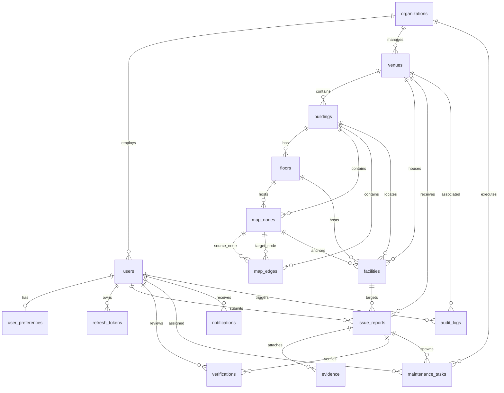

# PathPulse Database & Entity Design

## Entity Relationship Overview

## Enumerations

| Enum Name | Allowed Values | Purpose |
|---|---|---|
| `UserRole` | `USER`, `CONTRIBUTOR`, `MODERATOR`, `ORGANIZATION_ADMIN`, `SUPER_ADMIN` | Role-based authorization and permission boundaries |
| `MobilityProfile` | `WHEELCHAIR`, `LIMITED_MOBILITY`, `VISUAL_IMPAIRMENT`, `HEARING_IMPAIRMENT`, `STROLLER`, `CUSTOM` | High-level accessibility persona applied during route queries |
| `ConnectionType` | `CORRIDOR`, `RAMP`, `STAIRS`, `ELEVATOR`, `DOOR` | Topological edge physical classification in navigation graphs |
| `OperationalStatus` | `OPERATIONAL`, `OUT_OF_SERVICE`, `UNKNOWN` | Real-time mechanical or operational availability of an asset |
| `VerificationLevel` | `CONFIRMED`, `UNVERIFIED`, `UNAVAILABLE` | Trust certainty of accessibility features to prevent false promises |
| `ReportCategory` | `BROKEN_LIFT`, `BLOCKED_RAMP`, `INACCESSIBLE_ENTRANCE`, `OTHER` | Category of crowdsourced physical barrier reported |
| `ReportStatus` | `SUBMITTED`, `UNDER_REVIEW`, `VERIFIED`, `ASSIGNED`, `RESOLUTION_SUBMITTED`, `CLOSED`, `REJECTED`, `REOPENED` | Complete lifecycle state machine for barrier resolution |
| `FacilityType` | `ELEVATOR`, `RAMP`, `ACCESSIBLE_RESTROOM`, `ENTRANCE`, `TACTILE_PAVING`, `PARKING_BAY`, `HELP_DESK` | Point-of-interest or accessibility equipment taxonomy |

## Entity Tables

### 1. `users`
Represents platform accounts across standard users, contributors, moderators, and institution staff.

| Field | Type | Purpose |
|---|---|---|
| `id` | `TEXT (UUID)` | Primary key |
| `email` | `TEXT` | Unique account email |
| `password_hash` | `TEXT` | Argon2/bcrypt hashed credentials |
| `name` | `TEXT` | Full display name |
| `role` | `UserRole` | Role assignment |
| `organization_id` | `TEXT (UUID)?` | Optional organization affiliation |
| `created_at` | `TIMESTAMP` | Account creation timestamp |
| `updated_at` | `TIMESTAMP` | Last profile update timestamp |

### 2. `user_preferences`
Navigation preferences configuring routing penalties and constraints.

| Field | Type | Purpose |
|---|---|---|
| `id` | `TEXT (UUID)` | Primary key |
| `user_id` | `TEXT (UUID)` | Foreign key to `users` (Unique, 1-to-1) |
| `mobility_profile` | `MobilityProfile` | Selected user navigation profile |
| `requires_step_free` | `BOOLEAN` | Hard exclusion flag for stairs |
| `requires_elevator` | `BOOLEAN` | Preference for elevator over ramps |
| `max_slope_percent` | `FLOAT?` | Maximum negotiable gradient |
| `min_door_width_cm` | `INT?` | Minimum required doorway clearance |
| `requires_tactile_paving` | `BOOLEAN` | Preference for routes with tactile ground indicators |
| `requires_audio_alerts` | `BOOLEAN` | Preference for audible cues and spoken prompts |
| `created_at` | `TIMESTAMP` | Record creation timestamp |
| `updated_at` | `TIMESTAMP` | Last update timestamp |

### 3. `organizations`
Institutions (hospitals, universities, transit hubs, malls) that manage venues.

| Field | Type | Purpose |
|---|---|---|
| `id` | `TEXT (UUID)` | Primary key |
| `name` | `TEXT` | Legal or administrative institution name |
| `slug` | `TEXT` | Unique URL-safe identifier |
| `created_at` | `TIMESTAMP` | Creation timestamp |
| `updated_at` | `TIMESTAMP` | Last update timestamp |

### 4. `venues`
Geographic campuses, sites, or public complexes.

| Field | Type | Purpose |
|---|---|---|
| `id` | `TEXT (UUID)` | Primary key |
| `organization_id` | `TEXT (UUID)?` | Managing organization foreign key |
| `name` | `TEXT` | Venue display name |
| `category` | `TEXT` | Category classification (e.g. Hospital, University) |
| `address` | `TEXT?` | Physical street address |
| `latitude` | `FLOAT` | Geographic latitude (-90 to 90) |
| `longitude` | `FLOAT` | Geographic longitude (-180 to 180) |
| `location` | `geography(Point, 4326)` | PostGIS spatial geometry for indexed radius queries |
| `created_at` | `TIMESTAMP` | Record creation timestamp |
| `updated_at` | `TIMESTAMP` | Last update timestamp |

### 5. `buildings`
Discrete multi-story structures within a venue.

| Field | Type | Purpose |
|---|---|---|
| `id` | `TEXT (UUID)` | Primary key |
| `venue_id` | `TEXT (UUID)` | Parent venue foreign key |
| `name` | `TEXT` | Building name |
| `building_code` | `TEXT?` | Internal campus identifier or code |
| `created_at` | `TIMESTAMP` | Record creation timestamp |
| `updated_at` | `TIMESTAMP` | Last update timestamp |

### 6. `floors`
Horizontal levels within a building.

| Field | Type | Purpose |
|---|---|---|
| `id` | `TEXT (UUID)` | Primary key |
| `building_id` | `TEXT (UUID)` | Parent building foreign key |
| `floor_number` | `INT` | Signed floor number (e.g. -1 for basement, 0 for ground) |
| `name` | `TEXT` | Display name (e.g. "Ground Floor", "Level 2") |
| `level_index` | `INT` | Vertical sorting index for 3D/floor rendering |
| `created_at` | `TIMESTAMP` | Record creation timestamp |
| `updated_at` | `TIMESTAMP` | Last update timestamp |

### 7. `map_nodes`
Graph vertices representing navigable points, entrances, rooms, and intersections.

| Field | Type | Purpose |
|---|---|---|
| `id` | `TEXT (UUID)` | Primary key |
| `building_id` | `TEXT (UUID)` | Parent building foreign key |
| `floor_id` | `TEXT (UUID)` | Parent floor foreign key |
| `node_type` | `TEXT` | Typology: ENTRANCE, INTERSECTION, ROOM, ELEVATOR_LOBBY |
| `name` | `TEXT?` | Human-readable label or room number |
| `x_coordinate` | `FLOAT` | Planar X coordinate in meters / floorplan space |
| `y_coordinate` | `FLOAT` | Planar Y coordinate in meters / floorplan space |
| `latitude` | `FLOAT?` | Optional georeferenced latitude |
| `longitude` | `FLOAT?` | Optional georeferenced longitude |
| `is_accessible` | `BOOLEAN` | Barrier-free status flag |
| `created_at` | `TIMESTAMP` | Record creation timestamp |
| `updated_at` | `TIMESTAMP` | Last update timestamp |

### 8. `map_edges`
Graph edges representing corridors, ramps, stairs, and vertical elevator links.

| Field | Type | Purpose |
|---|---|---|
| `id` | `TEXT (UUID)` | Primary key |
| `building_id` | `TEXT (UUID)` | Parent building foreign key |
| `from_node_id` | `TEXT (UUID)` | Source node foreign key |
| `to_node_id` | `TEXT (UUID)` | Target node foreign key |
| `connection_type` | `ConnectionType` | Physical medium (CORRIDOR, RAMP, STAIRS, ELEVATOR, DOOR) |
| `distance_meters` | `FLOAT` | Metric traversal distance (>= 0) |
| `step_free` | `BOOLEAN` | Indicates zero steps on path |
| `width_cm` | `INT?` | Narrowest pathway clearance |
| `slope_percent` | `FLOAT?` | Ramp incline percentage |
| `surface` | `TEXT?` | Paving or flooring texture |
| `operational_status` | `OperationalStatus` | Operational state (OPERATIONAL, OUT_OF_SERVICE) |
| `verification_level` | `VerificationLevel` | Trust level (CONFIRMED, UNVERIFIED, UNAVAILABLE) |
| `created_at` | `TIMESTAMP` | Record creation timestamp |
| `updated_at` | `TIMESTAMP` | Last update timestamp |

### 9. `facilities`
Accessibility amenities and equipment (lifts, ramps, restrooms, entrances).

| Field | Type | Purpose |
|---|---|---|
| `id` | `TEXT (UUID)` | Primary key |
| `venue_id` | `TEXT (UUID)` | Venue foreign key |
| `building_id` | `TEXT (UUID)?` | Building foreign key |
| `floor_id` | `TEXT (UUID)?` | Floor foreign key |
| `node_id` | `TEXT (UUID)?` | Associated graph node foreign key |
| `facility_type` | `FacilityType` | Asset type classification |
| `name` | `TEXT` | Facility label |
| `operational_status` | `OperationalStatus` | Current operational state |
| `verification_level` | `VerificationLevel` | Operational confirmation rating |
| `last_verified_at` | `TIMESTAMP?` | Last physical audit date |
| `created_at` | `TIMESTAMP` | Record creation timestamp |
| `updated_at` | `TIMESTAMP` | Last update timestamp |

### 10. `issue_reports`
Crowdsourced barrier complaints and maintenance tickets.

| Field | Type | Purpose |
|---|---|---|
| `id` | `TEXT (UUID)` | Primary key |
| `user_id` | `TEXT (UUID)` | Submitting user foreign key |
| `venue_id` | `TEXT (UUID)` | Target venue foreign key |
| `facility_id` | `TEXT (UUID)?` | Affected facility foreign key |
| `category` | `ReportCategory` | Barrier classification |
| `title` | `TEXT` | Summary headline |
| `description` | `TEXT` | Detailed user narrative |
| `status` | `ReportStatus` | Workflow stage |
| `created_at` | `TIMESTAMP` | Submission timestamp |
| `updated_at` | `TIMESTAMP` | Last status transition timestamp |

### 11. `evidence`
Photographs and uploaded proof verifying barrier existence or repair.

| Field | Type | Purpose |
|---|---|---|
| `id` | `TEXT (UUID)` | Primary key |
| `report_id` | `TEXT (UUID)` | Parent issue report foreign key |
| `image_url` | `TEXT` | Public/CDN asset URL |
| `file_key` | `TEXT` | S3/MinIO object key |
| `caption` | `TEXT?` | Explanatory note |
| `uploaded_at` | `TIMESTAMP` | Upload timestamp |

### 12. `verifications`
Moderator or community audit records for submitted reports.

| Field | Type | Purpose |
|---|---|---|
| `id` | `TEXT (UUID)` | Primary key |
| `report_id` | `TEXT (UUID)` | Issue report foreign key |
| `reviewer_id` | `TEXT (UUID)` | Auditor user foreign key |
| `decision` | `TEXT` | Audit decision (APPROVED, REJECTED, NEEDS_INFO) |
| `notes` | `TEXT?` | Moderator evaluation notes |
| `created_at` | `TIMESTAMP` | Review timestamp |

### 13. `maintenance_tasks`
Operational work orders assigned to institution staff to fix barriers.

| Field | Type | Purpose |
|---|---|---|
| `id` | `TEXT (UUID)` | Primary key |
| `report_id` | `TEXT (UUID)` | Originating issue report foreign key |
| `organization_id` | `TEXT (UUID)` | Responsible organization foreign key |
| `assigned_to_id` | `TEXT (UUID)?` | Assigned staff member foreign key |
| `status` | `TEXT` | Work status (PENDING, IN_PROGRESS, RESOLVED) |
| `priority` | `TEXT` | Urgency tier (LOW, MEDIUM, HIGH, URGENT) |
| `resolution_notes` | `TEXT?` | Notes detailing the physical repair |
| `resolved_at` | `TIMESTAMP?` | Completion timestamp |
| `created_at` | `TIMESTAMP` | Work order creation timestamp |
| `updated_at` | `TIMESTAMP` | Last update timestamp |

### 14. `notifications`
In-app and system notifications for status updates and alerts.

| Field | Type | Purpose |
|---|---|---|
| `id` | `TEXT (UUID)` | Primary key |
| `user_id` | `TEXT (UUID)` | Recipient user foreign key |
| `title` | `TEXT` | Notification header |
| `message` | `TEXT` | Notification body |
| `link` | `TEXT?` | Direct deep-link URL |
| `read_at` | `TIMESTAMP?` | Read receipt timestamp |
| `created_at` | `TIMESTAMP` | Dispatch timestamp |

### 15. `audit_logs`
Immutable compliance and security log recording every sensitive mutation.

| Field | Type | Purpose |
|---|---|---|
| `id` | `TEXT (UUID)` | Primary key |
| `user_id` | `TEXT (UUID)?` | Actor user foreign key |
| `action` | `TEXT` | Action code (e.g. FACILITY_STATUS_CHANGED, REPORT_VERIFIED) |
| `entity_type` | `TEXT` | Target entity table name |
| `entity_id` | `TEXT` | Target entity primary key |
| `venue_id` | `TEXT (UUID)?` | Venue context foreign key |
| `changes` | `JSONB?` | Old and new state snapshot |
| `created_at` | `TIMESTAMP` | Event timestamp |

### 16. `refresh_tokens`
Cryptographically secure refresh tokens for authentication sessions.

| Field | Type | Purpose |
|---|---|---|
| `id` | `TEXT (UUID)` | Primary key |
| `user_id` | `TEXT (UUID)` | User foreign key |
| `token_hash` | `TEXT` | SHA-256 hashed refresh token |
| `expires_at` | `TIMESTAMP` | Expiration timestamp |
| `revoked` | `BOOLEAN` | Revocation status flag |
| `created_at` | `TIMESTAMP` | Creation timestamp |

---

## Decision Records

### DR-ID: Primary Key Strategy — UUIDv4 (`@default(uuid())`)

- **Decision**: All entities utilize 128-bit RFC 4122 UUIDv4 identifiers.
- **Rationale**:
  - **Open Database Interoperability**: UUID is natively supported across PostgreSQL (`uuid` / `gen_random_uuid()`), PostGIS spatial functions, Python FastAPI, and mobile clients without proprietary SDK dependencies.
  - **Distributed Generation**: Clients and backend services can pre-allocate identifiers before batch insertion without database round-trips.
  - **Security & Obfuscation**: Prevents enumeration attacks across URLs, public venue IDs, reports, and evidence tokens.
  - **Storage & Index Efficiency**: UUIDs map to 16 bytes in PostgreSQL, outperforming 25-character CUID strings in B-tree index density and memory cache footprint.

### DR-DEL: Foreign Key Deletion Behavior

- **Hierarchical Spatial Containers (`Cascade`)**:
  - `Venue` $\rightarrow$ `Building` $\rightarrow$ `Floor` $\rightarrow$ `MapNode` $\rightarrow$ `MapEdge`:
  - When a venue or building is removed, orphan nodes, edges, and floors have no spatial meaning and are automatically cascade deleted.
  - Similarly, deleting a user account cascades to `user_preferences`, `notifications`, and `refresh_tokens`.
- **Audit Trails and Account Independence (`Restrict` / `SetNull`)**:
  - `IssueReport.user_id` $\rightarrow$ `User`: Set to `Restrict` so user accounts cannot be deleted while active barrier reports depend on them, preserving chain-of-custody.
  - `Verification.reviewer_id` $\rightarrow$ `User`: Set to `Restrict` to prevent erasing the reviewer identity on verified or rejected reports.
  - `AuditLog.user_id` $\rightarrow$ `User`: Set to `SetNull` to preserve immutable audit history even if a former employee or administrator account is archived.
  - `MaintenanceTask.assigned_to_id` $\rightarrow$ `User`: Set to `SetNull` so tasks remain in the organization queue when staff reassignments or departures occur.

### DR-TRG: Elevator Floor Constraint Strategy (Trigger vs Deferred Check)

- **Requirement**: An `ELEVATOR` edge must connect two nodes situated on different floors.
- **Decision**: Implemented via a PostgreSQL `BEFORE INSERT OR UPDATE` trigger function (`check_elevator_different_floors`).
- **Rationale**:
  - PostgreSQL `CHECK` constraints are column-local or row-local to the single table being evaluated; they cannot perform subqueries or join across parent foreign keys (`map_nodes.floor_id`).
  - While a deferred constraint trigger is required when cross-referencing mutually dependent rows inserted in arbitrary order, navigation nodes are strictly persisted before edges can link them.
  - An immediate `BEFORE INSERT OR UPDATE` row-level trigger validates the condition instantaneously at execution time, failing early with a descriptive error message before committing any invalid edge topology.

